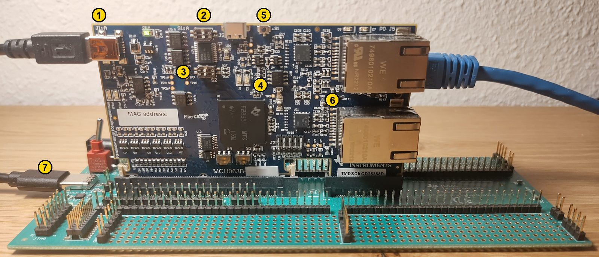
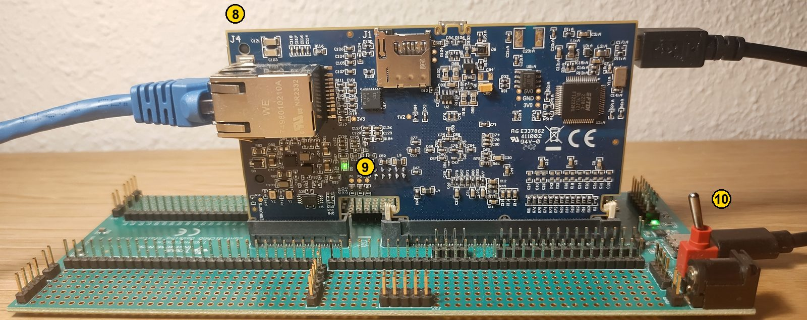

# TMDSCNCD28388D controlCARD

The examples run on the TMDSCNCD28388D controlCARD (F28388D) in the
TMDSHSECDOCK docking station. CPU1 runs `cpu1_bootstrap`, the Connectivity
Manager runs micro-ROS.

Front:

Back:

| # | Part | Use |
| --- | --- | --- |
| 1 | J1:A, mini-USB | On-card XDS100v2 debug probe: cable to the PC |
| 2 | S1:A | Debug probe and UART switches, see below |
| 3 | S2 | Boot mode, see below |
| 4 | D1, D2 | Red LEDs, see below |
| 5 | S1 | Reset button |
| 6 | J5, J6 | EtherCAT, not used |
| 7 | USB-C on the docking station (POWER ONLY) | Power |
| 8 | J4, on the back | Ethernet: cable to a network card of the PC |
| 9 | D5, on the back | Green: the controlCARD is powered |
| 10 | S1 of the docking station (red toggle) | Power source, see below |

## Switch settings

The same settings serve debugging and standalone operation:

| Switch | Setting | Effect |
| --- | --- | --- |
| S1:A (2) | 1 ON, 2 ON | 1 connects the XDS100v2 to the device (JTAG); 2 connects the isolated UART on GPIO28, which the examples do not use |
| S2 (3) | 1 OFF, 2 OFF | Boot from flash (GPIO84 = 1, GPIO72 = 1) when the board starts on its own; debug sessions load and start the programs themselves |
| Docking station S1 (10) | USB-ON: lever away from the board edge | Power from the USB-C connector (7); toward the board edge (EXT-ON), from the 5 V barrel jack below the switch |

For standalone operation, build `cpu1_bootstrap` in the `CPU1_FLASH`
configuration and program both cores.

## LEDs

| LED | Meaning |
| --- | --- |
| D1, red | Connectivity Manager (examples): blinks at 1 Hz while waiting for the agent, on while connected, blinks at 5 Hz if the initialization failed |
| D2, red | CPU1 (`cpu1_bootstrap`): blinks at 1 Hz |
| D2:A, green | XDS100v2 powered (USB on J1:A) |
| D5, green | controlCARD powered |
| On J4 | Ethernet link and activity |

## References

- [TMDSCNCD28388D](https://www.ti.com/tool/TMDSCNCD28388D) and its
  [controlCARD information guide](https://www.ti.com/lit/pdf/spruil8)
  (connectors, switches, LEDs)
- [TMDSHSECDOCK](https://www.ti.com/tool/TMDSHSECDOCK)
